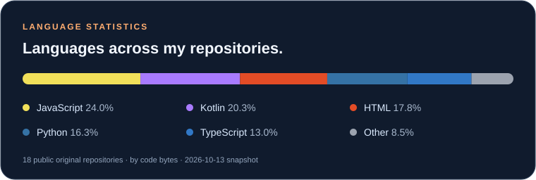

<h1 align="center">Hi, I'm Zimo Xu</h1>

<samp>AI-assisted development · Full-stack projects · Open source</samp>

## 👋 About Me

I'm a developer and **OpenClaw contributor** from **Hangzhou, China**, currently a first-year undergraduate at **Communication University of Nanjing (CUCN)**, enrolled in September 2026.

I started exploring **Vibe Coding** in 2025 and have since built practical applications with large language models. I enjoy turning everyday needs into useful software, taking projects from an initial idea through implementation and deployment. Alongside building, I'm continuously strengthening my programming fundamentals and learning from the open-source community.

## 🛠️ What I Build

My work spans web applications, learning tools, monitoring dashboards, and AI-powered workflows. I use natural language to explore ideas and accelerate development, then refine the results through iteration and hands-on testing.

I'm especially interested in the connection between **AI agents and practical software**: how assistants can automate repetitive tasks, support development, and help people get more done. I run OpenClaw on both my local PC and server to explore these workflows in everyday use.

## 🌱 Open-Source Contributions

### [OpenClaw](https://github.com/openclaw/openclaw)

I contribute to feature development in OpenClaw, an open-source personal AI assistant that runs locally and connects to multiple messaging platforms.

Working with an existing codebase gives me opportunities to learn through collaboration, understand how features fit into a larger system, and contribute beyond my own projects. My interests here center on AI assistants, application integrations, and workflow automation.

## 🚀 Selected Projects

### [gaokao-vocab](https://github.com/Jimmy-xuzimo/gaokao-vocab)

An independently developed vocabulary-learning application for the Gaokao, featuring **3,817 words**, flashcards, daily quizzes, and learning-data visualization. This project brings study content, interactive practice, and progress tracking together in one application.

### [Chronos-Monitoring](https://github.com/Jimmy-xuzimo/Chronos-Monitoring)

A **Python-based monitoring dashboard** for Linux and NAS servers, displaying real-time hardware and network metrics. Its industrial sci-fi visual style combines my interest in practical developer tools with attention to interface design.

### [about-me](https://github.com/Jimmy-xuzimo/about-me)

A responsive personal website built with **HTML, CSS, and JavaScript**, featuring English/Chinese language switching and light/dark themes. Deployed on **GitHub Pages**, it publishes automatically when the main branch is updated.

## 🧰 Tools & Technologies

- **Web Development:** TypeScript, React, Vite, Tailwind CSS, Node.js
- **Python & Backend:** Python, Flask
- **AI & LLMs:** Gemini, ChatGPT, Claude, Qwen, Kimi
- **Development Tools:** Cursor, Trae, Google AI Studio

## 🧭 What I'm Exploring

I'm continuing to develop my skills in full-stack web development, AI-agent integration, and deployment. My goal is to keep shipping useful projects, deepen my understanding of the code behind them, and contribute more to the communities I learn from.

---

## 📊 Language Statistics

Language share by code bytes in public, non-fork repositories; snapshot: October 13, 2026. This is a repository snapshot, not a measure of proficiency or contribution count.

## 💌 Let's Connect

Happy to chat about AI workflows, useful tools, and open-source collaboration.

**Email:** [xuzimojimmy@163.com](mailto:xuzimojimmy@163.com)

**[Explore my personal website →](https://jimmy-xuzimo.github.io/about-me/)**
